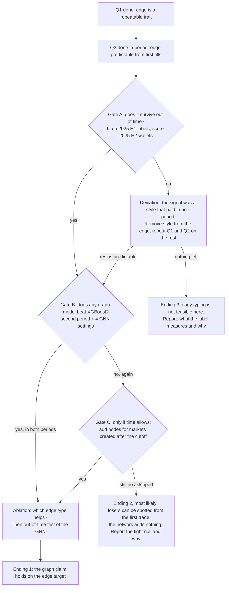

# Skilled or Lucky? Early trader typing on Polymarket trading graphs

COMP 5222 group project (Mukhanov, Lin, Bayraktar). Original proposal: `proposal.pdf`.
Lab notebook with every number: `NOTES.md`. This page is the map. Status: 15 Nov 2026.

## The project in one minute

**Question.** On Polymarket every trade is public and every market eventually resolves, so we can
score how well each wallet bets. From a wallet's **first few trades**, can we predict how well it
will bet later, and does the **trading graph** (who trades with whom, in which markets) help beyond
the wallet's own trades?

**Answer so far.**
1. A wallet's betting quality is a real, repeatable trait, mostly on the losing side: wallets that
   lose keep losing; wallets that win mostly do not keep winning.
2. It can be predicted early. One observed trade already ranks new wallets by their later result
   (correlation 0.22), if the model is trained on the right target.
3. The graph adds nothing so far. Graph neural networks tie a plain gradient-boosted tree that sees
   only the wallet's own trades.

**Not settled yet.** Points 2 and 3 were measured inside one six-month window. The out-of-time test
and a second period are written and waiting for the GPU server (see the decision tree below).

## The idea in plain words

| Term | Meaning here |
|---|---|
| wallet | one trader account; a **node** of our graph |
| market | a yes/no question that resolves to 1 or 0 |
| fill | one trade between a taker and a maker; an **edge** of the graph |
| bet | a wallet's whole position in one market (many fills, one outcome) |
| edge (of a bet) | outcome minus the fair price, in cents per share. Positive = the wallet got a good deal |
| z | a wallet's average edge divided by what luck alone would produce. z > 2 = "better than luck" |
| cutoff | the date that separates what a model may see from what it must predict (1 Jan 2025) |
| k | how many of a wallet's first post-cutoff fills the model may look at (1, 3, 5, 10, 20, 50) |
| new / existing wallet | no trades before the cutoff / has a history and a place in the graph |
| label | what we predict: computed only from bets placed **after** the k observed fills |

Why it is hard: with 30 bets, luck and skill look almost the same. Why a graph might help: a new
wallet has no history, but its first trades connect it to counterparties and markets that do.

### What we compare

Each row sees strictly more than the row above. A fair claim for the graph needs it to beat the rows
that do not use it.

| Role | Method | What it knows |
|---|---|---|
| baseline | history-only | the wallet's own resolved bets so far (nothing learned) |
| baseline | XGBoost, own features | numbers describing the wallet's own trades (prices, sizes, categories) |
| simple graph | XGBoost + neighbour aggregates | the same, plus averages over its counterparties and markets |
| classic graph | label propagation, spectral embedding | graph structure only (iteration 1) |
| well-known GNN | GraphSAGE | own features + learned messages from counterparties |
| **our model** | hetero GraphSAGE | the same on a wallet–market graph with "moved-first" edges (who bets before whom); new wallets enter as query nodes through their first k fills |

### Rules that keep the comparison honest

1. **No peeking.** Inputs use only trades before the cutoff plus the k observed fills; labels use
   only later bets in other markets. The code asserts this for every k.
2. **Same wallets, same splits for every method**, so differences are paired.
3. **Uncertainty on every number**: 5 seeds or 5-fold cross-validation, bootstrap confidence
   intervals, and paired intervals for "A minus B".
4. **The success rule is fixed before the run** (proposal §5): the graph claim holds only if a graph
   model beats both baselines on new wallets at every k ≤ 10.
5. **A null result is reported as a result**, with how tight it is.

## The story so far

| Step | Question | What we found | What it changed |
|---|---|---|---|
| Proposal (30 Oct) | Can a GNN type traders (skilled / lucky / unlucky / unskilled) early? | Plan: labels from market resolution, GraphSAGE vs baselines | starting point |
| Iteration 1 | Does the pipeline work? Are there skilled wallets? | 37k labelled wallets; strict "skilled" is 0.2%, so we used z > 2 (2%). GraphSAGE best, but only for wallets with history | need a setting for **new** wallets |
| Iteration 2 | Does the graph help new wallets from their first k fills? | No method beats the 2% base rate by much at k ≤ 10; too noisy to be sure | need more statistical power |
| Iteration 3 | Is that a real null or noise? | Real: graph adds < 0.007 AUPRC. But the models rank wallets **backwards**: z > 2 rewards wallets with wild results, not good ones | **deviation 1: the target is wrong** |
| Iteration 4a | What does the label measure? | Betting quality repeats (half-to-half correlation 0.25), almost all of it among losers | predict the edge itself, not "z > 2" |
| Iteration 4b | Which target should models learn? | Regression on edge: correlation 0.22 from one fill; the z > 2 classifier: −0.11 | new headline metric: ranking by later edge |
| Iteration 4c | Does the graph help on the new target? | No: every graph model within ±0.02 of XGBoost, new and existing wallets | **deviation 2: the likely ending is a careful null for the graph** |

Figures: `outputs/figures/exp4_train_label_diag.png` (what the label measures) and
`outputs/figures/exp4_train_graph.png` (graph models vs baselines).

## Where we go from here

Three questions, in order. Each one is a small win on its own, and each decides what the next step is.

| | Question | Status |
|---|---|---|
| Q1 | Is there something real to predict? | **Yes** (iteration 4a) |
| Q2 | Can it be predicted early, without a graph? | **Yes inside one period.** Out-of-time test pending (Gate A) |
| Q3 | Does the graph add anything? | **No so far.** Second period and larger settings pending (Gate B) |



**We are at Gate A and Gate B.** Both run on the server with one command (`bash run_server.sh`).

| Gate | Run | Pass rule (fixed now, before the run) | If it fails |
|---|---|---|---|
| A | `15_out_of_time.py train test` | new wallets, every k ≤ 10: edge-regression correlation has a 95% CI above 0 and above history-only | style/period deviation: next step 4 in `NOTES.md` |
| B | `run_server.sh edge`, then `grid` | proposal rule on the edge metric: a graph model beats both baselines on new wallets at every k ≤ 10 (paired CI > 0), in **both** periods. Report every setting, not the best one | Gate C or Ending 2 |
| C | not written yet | same rule as B | Ending 2 |

No compute needed, can happen any time:

- **Label decision (whole group).** Headline target = continuous edge; keep z > 2 AUPRC as the
  rare-class metric; decide whether wallets that only buy near-certain outcomes count as skilled.
- **Proposal checklist** below.

### Deliverables promised in the proposal

| Item | State |
|---|---|
| Time-correct pipeline, one cutoff, released statistical test | done |
| Four-type labels | done (`03_labels.py`); macro-F1 over the four types **open** |
| Baselines: history-only, XGBoost | done |
| Label propagation, node2vec-style embedding (spectral stand-in), GraphSAGE | done (iteration 1) |
| Wallet–market graph, moved-first edges | done (iteration 2) |
| Detection curve over k with error bars | done for z > 2 and for edge |
| Second cutoff (1 Jul 2025) as test | code written, **not run** |
| Leiden communities + ARI/NMI against the types | **open** (CPU, cheap) |
| Wash-trade community filter, fees in profit | **open** |
| TGN / DyGFormer, self-supervised pretraining | not started; only worth it if Gate B passes |

## How to run

### Setup

```bash
# Python 3.10–3.12. uv is fastest; plain pip works too.
uv venv --python 3.11 && source .venv/bin/activate
uv pip install -e ".[community,dev]"
# CPU torch is fine for the MVP. On a CUDA box install the matching torch wheel first.
python -m pytest -q tests          # sanity checks for the skill test
```

### Pipeline

```bash
bash run_mvp.sh train      # cutoff 2025-01-01 (graph Jul–Dec 2024, labels Jan–Jun 2025)
bash run_mvp.sh test       # cutoff 2025-07-01 (needs Jan–Dec 2025 trades, ~4.5 GB more)
```

| Step | Script | Output (`data/processed`, `outputs/`) | Time* |
|---|---|---|---|
| 0 | `scripts/download.py` | `data/raw/` (HF parquet, day-partitioned trades) | ~1 min / 3 GB |
| 1 | `01_prepare.py` | `data/interim/{split}_{graph,label}_fills.parquet` | ~45 s |
| 2 | `02_eda.py` | `outputs/figures/eda_*.png`, `outputs/tables/eda_*.json` | ~20 s |
| 3 | `03_labels.py` | `{split}_labels.parquet`, `{split}_calibration.parquet` | ~35 s |
| 4 | `04_build_graph.py` | `{split}_features.parquet`, `{split}_adj.npz` | ~1 min |
| 5 | `05_experiments.py` | `outputs/tables/exp1_*` | 30 s (no GNN) |
| 6 | `06_plot_results.py` | `outputs/figures/exp1_*_detection.png` | 5 s |
| 7 | `07_first_k.py` | `{split}_fk_{pop,obs,feat}.parquet`: first-k populations, per-k leakage asserts | ~1.5 min |
| 8 | `08_hetero_graph.py` | `{split}_hetero.pt` (PyG HeteroData, frozen at the cutoff), `{split}_fk_mf.parquet` | ~4 min |
| 9 | `09_first_k_experiments.py` | `outputs/tables/exp2_parts/` (one CSV per k × method) | ~35 min (GNNs) |
| 10 | `10_first_k_report.py` | `exp2_*_{raw,summary,paired}.csv`, `outputs/figures/exp2_*_detection.png` | 5 s |
| 9 cv | `09_first_k_experiments.py ... cv` | 5-fold CV, every wallet scored once: `outputs/tables/exp3_parts/`, `data/processed/exp3_preds/` | ~50 min* |
| 11 | `11_rank_report.py` | pooled AUPRC / precision@100 / Spearman with label z (+ bet-bucket stratified), bootstrap CIs: `exp3_*_{pooled,paired,buckets}.csv`, `outputs/figures/exp3_*_detection.png` | ~7 min |
| 12 | `12_label_diagnostics.py` | label diagnostics, no training: edge by role / price band, split-half reliability and persistence of the edge, variance function, exp3 scores vs realised edge: `exp4_*_{edge_role,reliability,persistence,variance,rescored,reference}.csv`, `outputs/figures/exp4_*_label_diag.png`, `data/processed/*_fk_halves.parquet` | ~10 min |
| 13 | `13_target_bakeoff.py` | candidate skill targets (XGBoost only), trained on one half of the label bets, judged on the other: `exp4_*_targets.csv` | ~4 min |
| 9 edge | `09_first_k_experiments.py ... cv edge` | all methods fit on the edge target (centred z of the even-week half of the label bets), GNNs with a regression head: `data/processed/exp4_preds/` | ~50 min* |
| 14 | `14_graph_on_edge.py` | graph models vs baselines on the held-out (odd-week) half, paired bootstrap, claim check: `exp4_*_graph{,_paired}.csv`, `outputs/figures/exp4_*_graph.png` | ~3 min |
| 15 | `15_out_of_time.py` | fit on one split, score a later one (XGBoost): `exp5_*_oot.csv`. Needs steps 1–7 for both splits | not run yet |

\*2-core / 7 GB machine (steps 7–10 timed on a 12-core Mac; 9 cv and 11–13 on a 10-core / 16 GB Mac). DuckDB does the heavy lifting out-of-core;
memory and threads are set in `prep.connect()` (2 threads by default, `PMGRAPH_THREADS=n` overrides: more
threads under the 5 GB cap spill heavily).

```bash
# iteration 2 (first-k inductive setting); 09 takes methods and k lists, so k values can run in parallel
python scripts/03_labels.py train all                      # market- and event-level labels
python scripts/07_first_k.py train && python scripts/08_hetero_graph.py train
python scripts/09_first_k_experiments.py train hist,xgb_own,xgb_nbr,sage,hgnn 1,3,5,10,20,50
python scripts/10_first_k_report.py train
# iteration 3: same methods in 5-fold CV, pooled out-of-fold metrics with bootstrap CIs
python scripts/09_first_k_experiments.py train hist,xgb_own,xgb_nbr,sage,hgnn 1,3,5,10,20,50 cv
python scripts/11_rank_report.py train
# iteration 4: what the skill label measures (no GNN), and which target to train on (XGBoost only)
python scripts/12_label_diagnostics.py train
python scripts/13_target_bakeoff.py train
python scripts/09_first_k_experiments.py train hist,xgb_own,xgb_nbr,sage,hgnn 1,3,5,10,20,50 cv edge   # after 12
python scripts/14_graph_on_edge.py train
```
### GPU server

`run_server.sh` runs everything that is too heavy for a laptop, in stages (`data prep diag edge oot`,
optional `grid`): both splits, the edge-target comparison of graph models with one k per GPU, the
out-of-time test (`15_out_of_time.py`: fit on train, score test) and, with `grid`, four GNN settings.
GNN training uses CUDA when available; settings can be overridden per process with
`PMGRAPH_GNN='{"hidden": 128}'` and kept apart with `PMGRAPH_TAG=name`.
```bash
bash run_server.sh            # all stages but grid; logs in outputs/logs/
bash run_server.sh grid       # afterwards, optional
git add outputs/tables outputs/figures && git commit -m "Server run" && git push   # data/ stays on the server
```

On macOS, xgboost and torch cannot share a process (two `libomp`, segfault); 09 runs XGBoost in a
subprocess, and for 05 run `xgb_*` and `sage` in separate calls (results merge per method).

Config: `configs/mvp.yaml` (windows, label thresholds, FDR level, seeds).

## Layout

```
configs/mvp.yaml          windows, label + cleaning settings, GNN settings
src/pmgraph/prep.py       raw trades -> canonical fills (one signed position on the reference token)
src/pmgraph/labels.py     calibration, bets, skill test, BH, four types
src/pmgraph/features.py   wallet features + counterparty graph (pre-cutoff only)
src/pmgraph/models.py     XGBoost, LR, spectral embedding, label propagation, sparse GraphSAGE
src/pmgraph/firstk.py     first-k populations: observed fills, post-k labels, leakage asserts
src/pmgraph/hetero.py     frozen wallet-market graph, query-node sampler, hetero GraphSAGE, trainer
src/pmgraph/tabular.py    torch-free XGBoost worker (subprocess)
src/pmgraph/rank_eval.py  pooled ranking metrics, bootstrap CIs (iteration 3)
src/pmgraph/label_diag.py split halves, persistence, edge metrics (iteration 4)
scripts/                  numbered pipeline steps (table above)
run_mvp.sh, run_server.sh laptop pipeline / GPU-server stages
tests/                    simulated nulls and planted effects for every statistical procedure
```

## Data

`vgregoire/polymarket-users` (Hugging Face, CC-BY 4.0). Tables used:
`trades/` (day-partitioned: `price, quantity, maker_address, taker_address, taker_bought, winner, …`),
`predictions.parquet` (token → market, outcome index), `markets.parquet` (`close_time`, fees).
`user_features` / `user_pnl_summary` are **lifetime** aggregates: never use them as features (leakage).

## Design decisions (beyond the proposal)

* **Reference token.** Every fill is mapped to the market's outcome-0 token: buying token 1 at *p*
  = shorting token 0 at 1 − *p*. Only binary markets (>99.99% of tokens).
* **Bet = (wallet, market) position**, not a fill. Fills in the same market share one outcome, so
  counting them separately inflates significance. Pure round-trips (|net direction| < 0.1) are dropped.
* **Skill statistic.** Per bet, *d* = A·W − C (signed outcome minus *calibrated* price, per share); per
  wallet, *T* = mean over bets. Null: W ~ Bernoulli(calibrated price), independent across markets.
  Analytic z-test (MC available; tests in `tests/`). BH at α = 0.10.
* **Favourite–longshot calibration** is fitted on markets that **closed before the cutoff**, with every
  market weighted equally. A per-fill fit is dominated by the 2024 election and bakes its outcome into
  the null.
* **Timezones.** DuckDB defaults to the machine's zone (HKT here); `connect()` pins UTC.
* **No fees** in profit yet (trades table has no fee column; fees only on some markets from Q4 2024).
