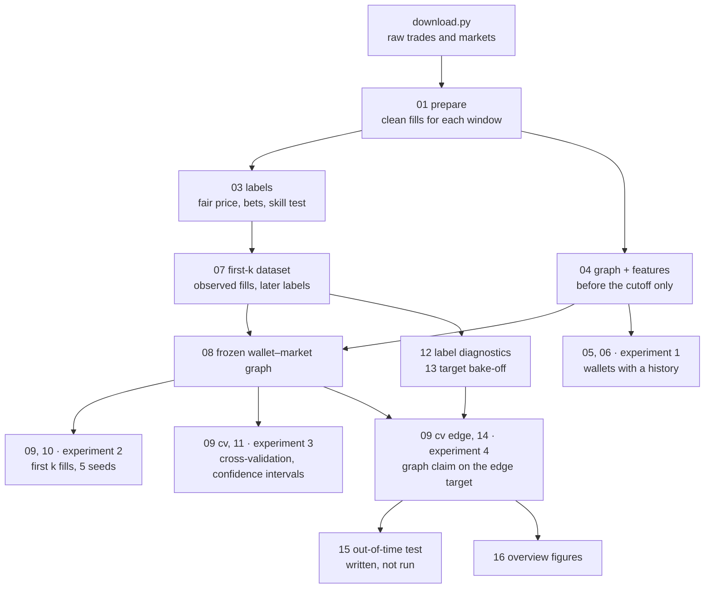

# Joining the project

For a group member (or a later reader) who wants to go from "just cloned" to "can run things and add
a result". The README is the map of the project; this page is the map of the repo and the work.

## 1. Read, in this order (30 minutes)

1. [README](../README.md), top to the decision tree: the question, the answer so far, the glossary,
   and where we are.
2. [`docs/RESULTS.md`](RESULTS.md): every figure in order, with how to read it.
3. [`NOTES.md`](../NOTES.md), **last iteration first**. It is a lab notebook in time order; the newest
   entry supersedes older readings (for example, iteration 4 replaces the explanation of the
   over-dispersion given in iterations 2–3).
4. `proposal.pdf` for what was promised; the README has the checklist of what is done.

## 2. Check your setup without downloading anything (10 minutes)

The result tables and figures are committed, so the repo can be checked before any data exists.

```bash
uv venv --python 3.11 && source .venv/bin/activate
uv pip install -e ".[community,dev]"
python -m pytest -q tests                      # 22 tests, about 30 s
python scripts/16_overview_figures.py train    # re-draws the two overview figures from outputs/tables/
```

If the tests pass and the figures draw, your environment is fine. (The PNG files may differ by a few
bytes between matplotlib versions; `git checkout outputs/figures` puts the committed ones back.)

Known traps:

| Symptom | Cause and fix |
|---|---|
| `XGBoost Library (libxgboost.dylib) could not be loaded` on macOS | OpenMP is missing: `brew install libomp` |
| segmentation fault when a script uses both XGBoost and torch on macOS | two OpenMP copies in one process. XGBoost must stay in `pmgraph/tabular.py` (it runs as a subprocess). For `05`, run `xgb_*` and `sage` in separate calls |
| a DuckDB query writes tens of GB to disk, then fails | too many threads under the memory cap. Leave the default of 2 (`PMGRAPH_THREADS`) |
| dates off by 8 hours | a DuckDB connection not made by `pmgraph.prep.connect()`, which pins UTC |

## 3. How the repo fits together



| Where | What | In git? |
|---|---|---|
| `scripts/NN_*.py` | the pipeline, one numbered step per file; each has a docstring with inputs, outputs and usage | yes |
| `src/pmgraph/` | library code the scripts call (module list in the README) | yes |
| `configs/mvp.yaml` | every window, threshold, seed and GNN setting | yes |
| `tests/` | simulated checks of every statistical procedure | yes |
| `outputs/tables/`, `outputs/figures/` | results: small CSV / JSON / PNG files | **yes**, results travel with the code |
| `data/` | raw trades and everything derived from them (about 6 GB for one split) | **no**, re-create with the pipeline |
| `NOTES.md` | dated lab notebook: what was run, numbers, reading | yes |

Result files are named by experiment and split: `exp4_train_graph.csv` is experiment 4 on the train
split. `exp1` to `exp4` match iterations 1 to 4 in `NOTES.md`.

## 4. Running the real pipeline

```bash
bash run_mvp.sh train     # download (3 GB), then steps 01–14; the GNN steps take about 2 hours on a laptop
```

After the download, everything up to step 08 takes about 10 minutes and is enough for most CPU tasks below. The step
table with outputs and times is in the [README](../README.md#pipeline). Heavy jobs (both periods, GNN
settings, out-of-time test) are staged in `run_server.sh` for the GPU server; only `outputs/tables`
and `outputs/figures` come back from there.

## 5. Rules that must not break

These keep the comparison honest. A result that breaks one of them is not a result.

1. **No leakage.** Model inputs use only trades before the cutoff plus the k observed fills. Labels
   use only later bets. Anything that uses market outcomes before the cutoff is limited to markets
   that closed before it. `user_features.parquet` and `user_pnl_summary.parquet` are lifetime totals:
   never model inputs.
2. **Same wallets and same splits for every method**, so differences can be paired.
3. **Uncertainty on every number**: seeds or cross-validation folds, bootstrap intervals, and a
   paired interval for "A minus B".
4. **The pass rule is written down before the run** (see the gates in the README).
5. **Old results are not edited.** A new idea gets a new experiment number; `exp1`–`exp4` stay as
   they were reported.

The technical versions (reference token, bet definition, memory limits) are in
[`CLAUDE.md`](../CLAUDE.md), which also briefs Claude Code when it works in this repo.

## 6. Adding an experiment

- [ ] New numbered script `scripts/NN_name.py` with a docstring: question, inputs, outputs, usage.
- [ ] Reusable logic goes in `src/pmgraph/`; any new statistical procedure gets a test that simulates
      the null (see `tests/test_label_diag.py` for the pattern).
- [ ] Results as rows in `outputs/tables/expN_{split}_*.csv`, figure in `outputs/figures/`.
- [ ] Figures use `pmgraph.plotstyle` so each method keeps its name and colour.
- [ ] Break results down by new / existing wallets and by k.
- [ ] A short dated entry in `NOTES.md`: what was run, the numbers, the reading, the caveats.
- [ ] If the story changes, update the tables in the README and add a section to `docs/RESULTS.md`.
- [ ] `python -m pytest -q tests` passes.

## 7. Open work

Ordered by how much the final report depends on it. "Laptop" means CPU, minutes to an hour.

| Task | Why it matters | Compute | Start here | Done when |
|---|---|---|---|---|
| Server run: Gate A (out of time) and Gate B (second period, GNN settings) | decides which ending the report has | GPU server | `run_server.sh`, gates table in the README | `exp5_*_oot.csv` and the test-split `exp4_*` tables are committed, with a `NOTES.md` entry stating pass or fail against the fixed rules |
| Label decision | fixes the headline target and metric | none (group discussion) | `NOTES.md`, iteration 4, "Recommendation for the group" | the decision is written in `NOTES.md` and the README |
| Leiden communities, ARI / NMI against the four types | promised in the proposal | laptop | `data/processed/train_adj.npz`, `train_labels.parquet`; `igraph` and `leidenalg` come with the `community` extra | table, figure, and a shuffled-label baseline for ARI / NMI |
| Macro-F1 over the four types | promised in the proposal | laptop | types from `03_labels.py`, models in `05_experiments.py` | per-class and macro F1 with seeds. Two classes have 86 and 8 wallets, so report per class |
| Fees in profit | promised; profit currently ignores fees | laptop | `src/pmgraph/labels.py`; `markets.parquet` has `has_fee`, `taker_base_fee` | labels with and without fees compared |
| Wash-trade filter | promised; groups of wallets that trade among themselves inflate the graph | laptop | `src/pmgraph/features.py` (graph construction) | share of volume removed and its effect on labels and results |
| Style versus the rest of the edge | is anything predictable beyond "how a wallet trades"? | laptop | `src/pmgraph/label_diag.py`, scripts 12 and 13; `NOTES.md` next step 4 | scripts 12–14 repeated on the residual |
| Nodes for markets created after the cutoff (Gate C) | the graph's last fair chance: most first trades of new wallets are in markets with no node | GPU server | `src/pmgraph/hetero.py`, `scripts/08_hetero_graph.py` | only if Gate B fails and time allows |
| Report and slides | the deliverable | none | `docs/RESULTS.md`, overview figures | — |

## 8. Working together

- One branch per task, a pull request into `main`, and a short summary of the result in the PR text.
- Commit code, `outputs/tables`, `outputs/figures` and the `NOTES.md` entry together, so a result
  never lands without the code that made it. Never commit `data/`.
- When a run is too heavy for a laptop, add it as a stage in `run_server.sh` and write in `NOTES.md`
  what the run will answer before it is started.
