# What happened, figure by figure

A reading guide to the project for someone who was not there. Each section is one step: the question
we asked, the figure that answers it, how to read that figure, and what it changed. Exact numbers,
caveats and run times are in [`NOTES.md`](../NOTES.md); the plan from here is in the
[README](../README.md#where-we-go-from-here). All results below are on the train split
(cutoff 1 Jan 2025). Words like *edge*, *z* and *k* are defined in the
[README glossary](../README.md#the-idea-in-plain-words).

Method names used in the older figures:

| In figures | Meaning |
|---|---|
| `hist` | history-only: the wallet's own past results, nothing learned |
| `xgb_own` | XGBoost (gradient-boosted trees) on numbers describing the wallet's own trades |
| `xgb_nbr` | the same, plus averages over the wallet's counterparties and markets |
| `spectral_lr`, `labelprop` | classic graph methods that use only who traded with whom |
| `sage` | GraphSAGE, a graph neural network on the wallet–wallet counterparty graph |
| `hgnn` | our model: GraphSAGE on a wallet–market graph with "moved-first" edges |

## 0. The task

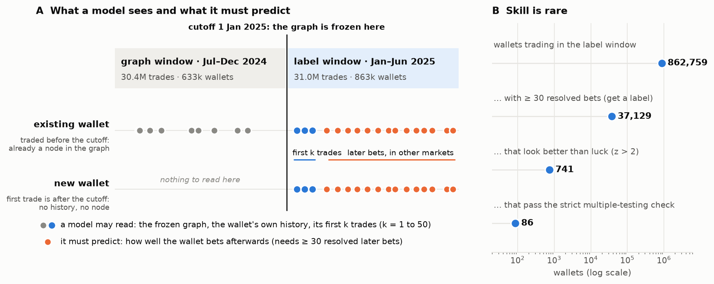

**A.** Everything before the cutoff is frozen into one graph. After the cutoff a model may also read a
wallet's first *k* trades. It must predict how well the wallet bets **afterwards**, in markets it has
not touched yet. An *existing* wallet has a history and a place in the graph; a *new* wallet has
neither, which is the case the proposal cares about.

**B.** Why this is hard: of 863k wallets, 37k place enough bets to be judged at all, 741 look better
than luck, and 86 survive a strict test. A model that hunts for "skilled" wallets is hunting for 2%.

The graph the models read:

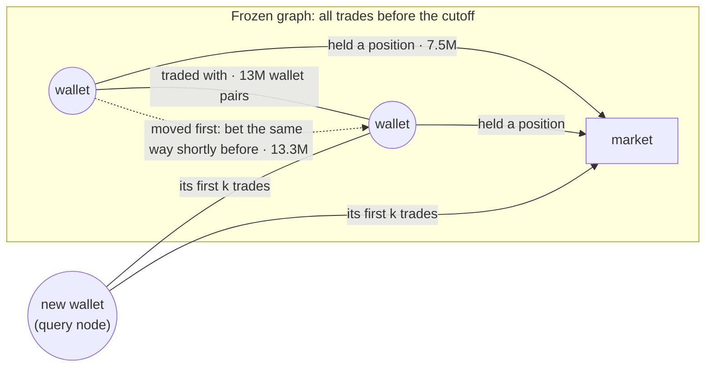

633k wallets and 13.3k markets. A scored wallet is a *query node*: it receives messages from the
frozen graph through its observed trades and sends none, so nothing after the cutoff leaks in.

## 1. Data and labels (iteration 1)

*Question: does the pipeline work, and are there skilled wallets at all?*

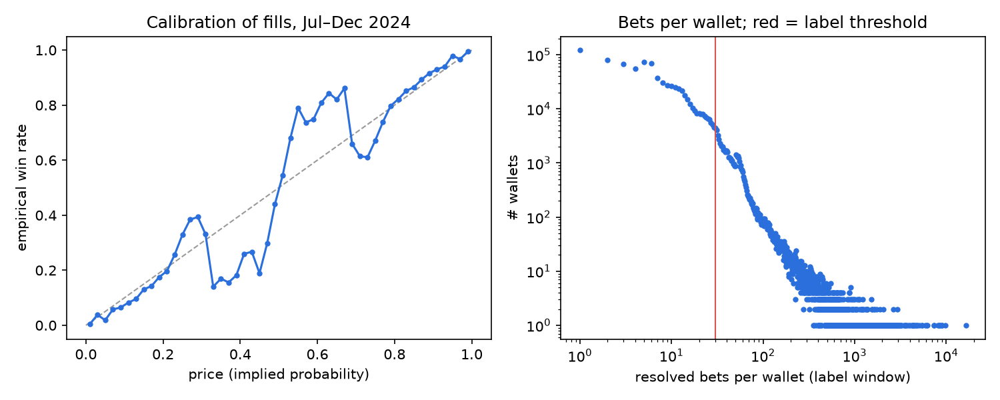

Left: if prices were perfect probabilities the blue line would sit on the dashed diagonal. The bumps
are the 2024 election, where a few huge markets dominate the trades. That is why the fair price is
fitted with every market counting equally (next figure), not every trade. Right: most wallets place a
handful of bets; only those right of the red line (30 resolved bets) get a label.

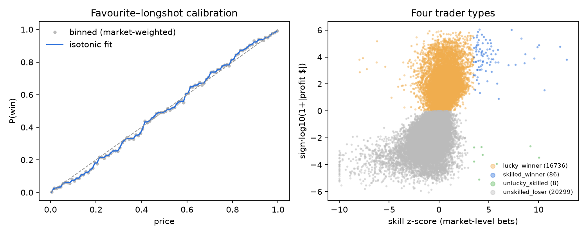

Left: the fair price we use, fitted on markets that closed before the cutoff. Right: every labelled
wallet by skill score (x) and profit (y). The four types of the proposal are the four colours. Blue
(skilled winner) is 86 wallets, 0.2%, far too few to train on, so iterations 1–3 used the looser
"z > 2" (2%).

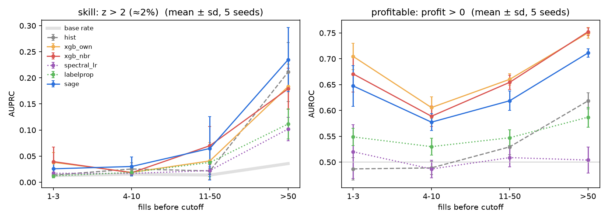

How to read: x is how active the wallet was before the cutoff; higher is better; the grey band
(left) is what guessing achieves. Left panel: GraphSAGE (blue) is best at finding z > 2 wallets, but only for
wallets with more than 50 trades. Right panel: for plain profitability, XGBoost wins.

**What it changed.** The graph helped only where a wallet already had a long history. The proposal's
claim is about *new* wallets, so we needed a setting that tests exactly that.

## 2. New wallets from their first k trades (iteration 2)

*Question: does the graph help classify a new wallet from its first k trades?*

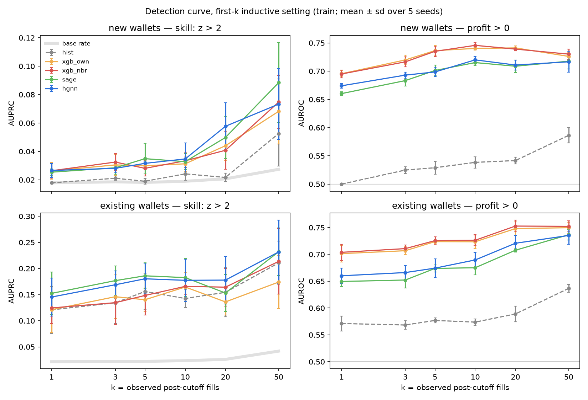

How to read: x is k, the number of trades seen; the top row is new wallets, the bottom row existing
ones. Top left is the proposal's claim: all coloured lines sit just above the grey base-rate band and
on top of each other until k = 20. Bottom left: with a history, the GNNs (green, blue) are above the
baselines.

**What it changed.** No method does much for new wallets, but with about 70 positive wallets per test
fold the error bars were as large as the effects. We could not tell "no effect" from "too noisy".

## 3. Is the null real? (iteration 3)

*Question: with every wallet scored once (5-fold cross-validation) and confidence intervals, does the
graph help new wallets?*

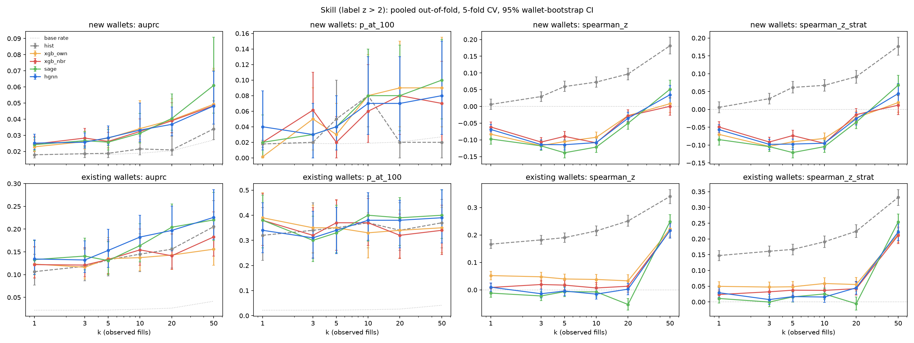

How to read: same axes, four metrics. The first column (AUPRC) repeats iteration 2 with tight
intervals: for new wallets the graph adds at most about 0.007. The third and fourth columns are the
surprise. They ask "does a higher model score mean a higher skill score?" and for new wallets every
trained model is **below zero** until k = 50: they rank wallets backwards. Only the untrained history baseline
(grey) is positive.

**What it changed.** The null for the graph is real. More important, the target was wrong: a model
trained to find "z > 2" learns to find wallets with *wild* results, in both directions, because those
cross the threshold most often. First deviation from the proposal.

## 4. What the label measures, and what to predict instead (iteration 4)

*Question: is there a stable trait behind the skill score, and which target lets a model learn it?*

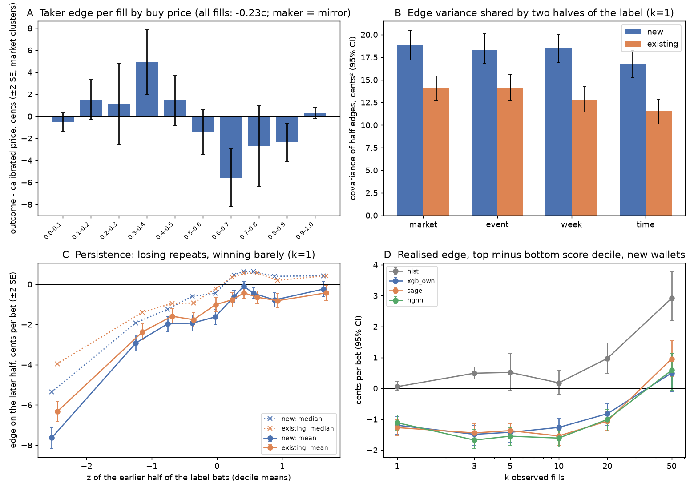

- **A.** Average result of takers by the price they bought at. Mostly small; one price band paid and
  one lost in this window (a caveat for later: this could be a one-period effect).
- **B.** Split each wallet's bets in two halves in four different ways. The halves always agree to the
  same degree, so a wallet's result is a property of the wallet, not an accident of which bets
  landed together.
- **C.** Sort wallets by their earlier half, look at the later half. The worst tenth keeps losing 6–8
  cents per bet. The best tenth ends up at about zero.
- **D.** Models trained on "z > 2" (colours), judged on realised result: below zero for new wallets
  until k = 50. This is the backwards ranking of iteration 3, measured in cents.

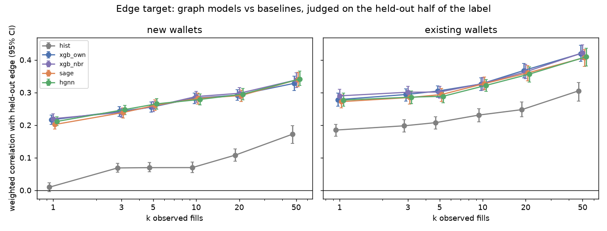

How to read: every model is now trained to predict the edge itself and judged on bets it never saw.
y is the correlation between the model's score and the wallet's later result. All four trained models
lie on one line, well above the untrained baseline.

**What it changed.** Predict the edge, not "z > 2". On that target a new wallet can be ranked from a
single trade, and the graph adds nothing. Second deviation: the likely ending is a careful null for
the graph.

## 5. Where that leaves us

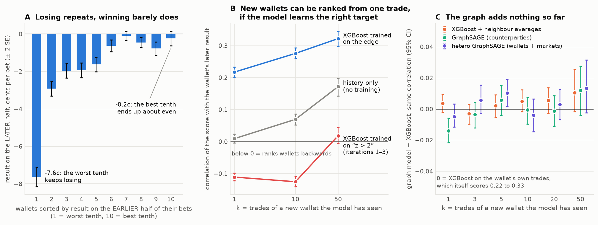

- **A.** There is something real to predict, mostly on the losing side.
- **B.** It can be predicted early. Same model, same inputs, only the training target differs: blue
  learns the edge, red learns "z > 2" and ranks new wallets backwards.
- **C.** Each dot is a graph model minus XGBoost on the same wallets, with a 95% interval. Everything
  is within about ±0.02 of zero, while XGBoost itself scores 0.22 to 0.33.

**Not settled.** All of this is inside one six-month window. Two runs decide the ending, and both are
written but not run yet: the out-of-time test (does B survive in the next half-year?) and a second
period with larger GNN settings (does C stay a tie?). See the
[decision tree](../README.md#where-we-go-from-here).

## 6. The graph's best chance (iteration 5)

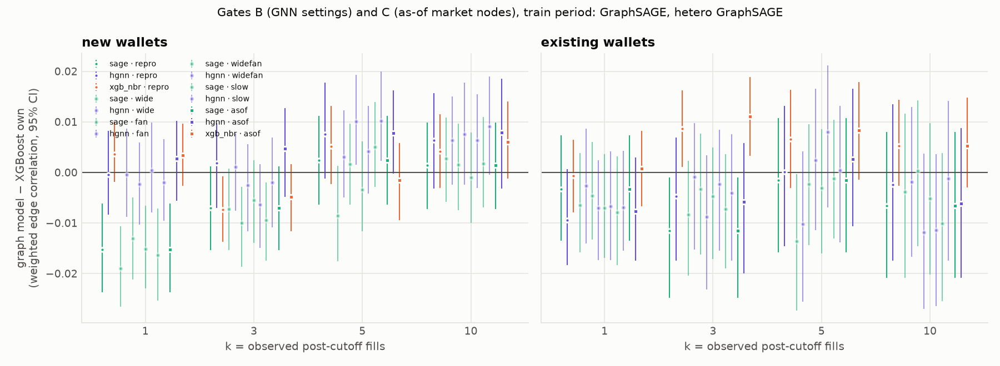

Two excuses remained for the graph null: the GNNs were never tuned, and most of a new wallet's first
trades are in markets that did not exist before the cutoff, so the market half of the graph never
reached it. Both were tested with the pass rule fixed in the README beforehand.

**How to read it.** Each bar is one graph model in one setting minus XGBoost on the wallet's own
trades, on the same wallets, with a 95% interval; above zero means the graph helped. Purple = hetero
GraphSAGE, green = GraphSAGE, orange = XGBoost + neighbour averages; square markers = with the new
as-of market nodes (Gate C), round = the four GNN settings and the default (Gate B).

**What it showed.** Nothing clears zero at every k ≤ 10, in any setting. Larger, wider or slower GNNs
move the result by under ±0.005; giving every first trade a market node (built only from what was
known at that moment) moves it by under +0.003. The pass rule fails 14 out of 14 times.

**What it changed.** Gates B and C are decided: the project is on Ending 2 (early trades predict
who keeps losing; the network adds nothing). The one open question is Gate A, whether the early
signal holds in the next half-year.

## Re-drawing the figures

| Figure | Script | Needs `data/`? |
|---|---|---|
| `overview_*_setup.png`, `overview_*_results.png` | `scripts/16_overview_figures.py` | no, reads `outputs/tables/` |
| `exp1_*_detection.png` | `scripts/06_plot_results.py` | no |
| `exp2_*_detection.png` | `scripts/10_first_k_report.py` | no |
| `eda_*.png`, `labels_*.png` | `scripts/02_eda.py`, `scripts/03_labels.py` | yes |
| `exp3_*_detection.png` | `scripts/11_rank_report.py` | yes (saved scores) |
| `exp4_*_label_diag.png`, `exp4_*_graph.png` | `scripts/12_label_diagnostics.py`, `scripts/14_graph_on_edge.py` | yes |
| `exp5_*_gates.png` | `scripts/18_gate_report.py` | no, reads `outputs/tables/exp4_*_graph*_<tag>.csv` |
